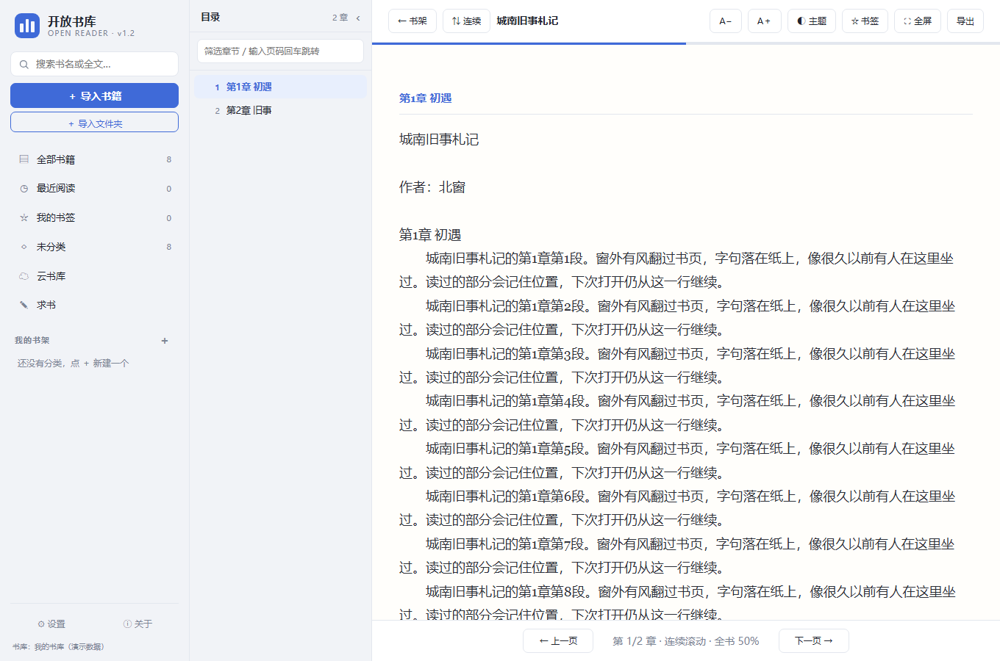

<p align="center">
  
</p>

# 开放书库 · OpenReader

免费、离线、开放格式的本地电子书阅读器。

Windows 一个 exe 双击即用，Android 装个 apk 就能看；书库就是一个可以直接拷走的文件夹——没有账号、没有加密容器、没有云同步绑架，你的书和阅读记录始终在自己手里。

- 产品名称：**开放书库（OpenReader）**
- 当前版本：PC **1.2.5** / Android **1.17.1**（versionCode 17，Android 7.0+）
- 包名：`com.openreader.app`
- 技术栈：Web（原生 JS + 纯标准 API）+ Electron（Windows）/ WebView（Android）双壳，同一套 core
- 在线更新：冷启动检查云端清单，发现新版提示下载；断网 / 站点休眠自动放行

---

## 一、它是什么

一个把「本地文件」当作唯一真相的阅读器。你给它一个文件夹，它把书、分类、封面、书签、阅读进度都写在里面；换电脑时复制这个文件夹即可，不需要导出、不需要登录、不需要等待同步。

| 适合 | 不适合 |
|---|---|
| 手里有一堆 TXT / EPUB / PDF，想统一整理、全文检索 | 想在线书城直接买书、看连载 |
| 希望断网、没信号、飞行模式下照常看书 | 需要多设备实时同步阅读进度 |
| 在意「哪天不用了能不能把书完整带走」 | 需要扫描版 PDF 的 OCR 文字识别 |
| 想给书分类、做备份、随时导出原件 | 需要打开加密 / DRM 文档 |

**整体架构**：格式解析、全文索引、阅读状态、备份编解码都在同一套 `core` 里，两端只换外壳；在线服务是可选的，连不上照常用。

<p align="center">
  
</p>

界面截图里的书名均为演示数据；本项目**不提供、不托管、不分发任何书籍内容**。

---

## 二、下载与安装

### Android

**固定下载地址（本仓库 Release 附件，永久不变）：**

```
https://gitee.com/zlbku/Open-reader/releases/download/latest/OpenReader.apk
```

安装：`OpenReader.apk` 约 479 KB，Android 7.0+。首次打开时授权书库目录，然后把书导入进来即可。

应用内「设置 → 应用更新 → 检查更新」会拉取云端清单，发现新版后从上面的固定地址下载安装，覆盖安装不影响书库数据。

<p align="center">
  
  &nbsp;&nbsp;
  
</p>

<p align="center"><sub>左：书架与底部导航　右：侧边栏（分类、云书库、求书、设置）</sub></p>

### Windows

PC 单文件版 `OpenReader-PC-1.2.5.exe`（约 98 MB）与卸载器 `OpenReader-Uninstaller.exe` 在项目的 GitHub Releases 与国内网盘发布，本仓库只托管安卓安装包。

**PC 端下载 / 更新地址（夸克网盘）**：https://pan.quark.cn/s/f70d9d4eff60

1. 双击 `OpenReader-PC-1.2.5.exe`（下载后建议改回中文名 `开放书库.exe`）。
2. 首次运行会展开运行文件（约 5~15 秒，**只做一次**），并询问书库存放位置；点「否」用默认位置。
3. 把 TXT / EPUB / PDF 拖进窗口，或点「导入书籍」。
4. 想换书库位置：在 exe 旁边新建一个空的 `重设书库位置.txt`，再双击 exe。
5. 想卸载：菜单栏「卸载」→ 确认一次即可。不写注册表、不在控制面板留卸载项。

升级不会丢书，覆盖安装即可。

---

## 三、三分钟上手

1. **导入**：侧栏点「＋ 导入书籍」选文件，或点「＋ 导入文件夹」一次收整本书架。也能把书直接拖进窗口。
2. **打开**：在书架点封面，进入阅读；左侧目录列章节，点章节直接跳。
3. **调舒服**：顶部 A− / A＋ 调字号，「◐ 主题」切换明亮 / 护眼 / 深夜；侧栏底部「⚙ 设置」里还能调字体、行距、翻书动画。
4. **继续读**：阅读进度自动保存，下次打开同一本书接着上次的位置；「最近阅读」和「我的书签」都能快速回去。

书和进度都存在本机，不上传。换电脑或重装前，先到「设置 → 导出整库」备份一份。

应用内置「? 帮助」抽屉，七组说明从导入到排错都有，断网也能查。

---

## 四、已实现功能

### 书架与整理

左侧分类树，右侧网格 / 列表切换，书卡显示封面、章节数与原件大小。

<p align="center">
  
</p>

| 能力 | 说明 |
|---|---|
| 分类树 | 新建 / 重命名 / 删除 / 隐藏分类，支持层级；把书拖到分类即归类 |
| 排序 | 按添加时间、书名、作者、大小、章节数等排序，可切换升序 / 降序 |
| 视图 | 封面网格 / 紧凑列表切换，封面尺寸大中小可调 |
| 批量操作 | 批量整理模式下多选，一次调整分类 / 移出分类 / 删除 |
| 封面 | 可为每本书设置封面，未设置时按书名生成色块封面 |
| 阅读进度 | 书卡显示章节数与进度，重新打开从上次位置继续 |
| 长按菜单 | 安卓端长按书卡弹出归类 / 重命名 / 导出 / 删除菜单 |

### 阅读体验

左侧常驻目录可筛选章节，顶部调字号、主题、书签、全屏，底部翻页并记住进度。

<p align="center">
  
</p>

- 常驻目录面板，支持按章节标题 / 页码筛选跳转
- 字号、行距、字体可调，三套阅读主题（明亮 / 护眼 / 深夜），书签增删与跳转
- 键盘翻页、手势翻页、连续滚动与分页双模式；安卓另有仿真「翻书」效果
- 双击正文进入 / 退出全屏，F11 也可切换
- 文字版 PDF 按页分章；扫描版 PDF 按原页图片连续浏览（不做 OCR）
- 进度自动记忆，断电或强退后仍能恢复

快捷键：`Ctrl / ⌘ + F` 搜索，`→ / 空格 / PageDown` 下一页，`← / PageUp` 上一页，`F11` 全屏，`Esc` 退出。

### 全文检索

输入关键词后显示命中章节与上下文摘要，点结果直接跳到对应位置。

<p align="center">
  
</p>

对书库建立索引后，输入任意中文子串即可搜到命中章节与上下文摘要，点结果直接跳读。导入新书后可手动「重建索引」。索引是派生数据，删掉可以随时重建，原件不受影响。

### 备份与迁移

| 方式 | 用途 |
|---|---|
| 备份导出 / 恢复 | 自定义文件名与保存位置，涵盖分类、封面、书签、进度、设置 |
| 原件导出 | 把 `source.<ext>` 原封不动导出来，字节不改 |
| `.openlib` 整库包 | 一次导入 / 导出整个书库，适合换电脑 |
| 直接复制文件夹 | 书库是普通目录，用文件管理器整目录拷走即可 |

**卸载应用会清空书库数据**，重装前务必先导出整库备份。

### 云书库、求书与反馈

客户端内置云书库浏览、求书提交与回复查看、意见反馈入口，以及启动时的更新检查。这些功能连接的是维护者部署的在线服务，**全部可选**：断网、服务不可用、清单拉取失败时一律静默跳过，不影响任何本地功能。

求书管理端填入的书籍链接会自动同步到书库，**书库只增不减**，不会删除你已有的书。

### 更新机制

启动 → 读取在线更新清单 → 拉取失败则静默跳过；有新版本则提示下载 → 从 Gitee 固定地址取包 → 校验 SHA-256 → 覆盖安装，书库数据不动。

当前发布版本走「整包下载」路线；PC 端补丁通道保留在代码中，用于对小改动做热更新，应用前备份、失败自动还原。强制更新时无法跳过，普通更新可选「稍后再说」。

---

## 五、支持格式

| 类别 | 格式 | 说明 |
|---|---|---|
| 纯文本 | TXT / MD / LOG / CSV / JSON / XML / SRT | UTF-8 与 GB18030 自动识别 |
| 电子书 | EPUB / FB2 / MOBI / PRC / PDB / AZW / AZW3（KF8） | PalmDOC 与 HUFF/CDIC 两种压缩都能读，KF8 按 h1/h2 恢复目录 |
| 文档 | DOCX / DOC（Word 97–2003）/ RTF / ODT / MHTML / HTML | 纯标准 API 解析 |
| PDF | 文字版 PDF | 按页分章，支持中文 ToUnicode CMap、对象流与常见滤镜 |
| 压缩包 | ZIP 内嵌电子书 | 自动解包取书 |
| 其它 | 未知扩展名 | 按内容嗅探纯文本 |

**不解析但完整保留原件**：CHM、DjVu、CBZ / CBR —— 可随时导出，不会损坏或丢弃。

**边界**：扫描版 PDF 不做 OCR，没有文字层、不支持全文检索；加密文档明确提示降级，不破解；带 DRM 加密的 MOBI / AZW3 同样无法解析，原件照常保留。

---

## 六、书库格式

书库就是普通文件夹，用文本编辑器或 SQLite 工具就能打开：

```
我的书库/
├─ library.json              # 书籍清单、分类树、封面、书签、进度、设置
├─ books/
│  └─ <book-id>/
│     ├─ source.<ext>        # 导入时的原始文件，永不改动
│     ├─ derived/text.txt    # 解析出的阅读文本（可重建）
│     └─ derived/meta.json   # 章节、分页等派生信息
└─ index.*                   # 全文索引（可重建）
```

三条原则：**原件只读**、**派生可重建**、**元数据是人能读的 JSON**。

---

## 七、数据与隐私

- 书籍、分类、封面、书签、进度、设置**全部存在本地书库文件夹**，不上传
- 无账号、无登录、无广告 SDK、无行为统计上报
- 联网只发生在你主动使用云书库 / 求书 / 反馈，以及启动时的更新清单拉取
- 更新补丁按文件校验 SHA-256，应用前备份，失败自动还原
- 不提供、不托管、不分发任何书籍；使用者需自行确保对所导入文件拥有合法权利

---

## 八、常见问题

**升级会丢书吗？** 不会。覆盖安装只替换程序文件，书库目录独立存放。

**换电脑怎么迁移？** 复制整个书库文件夹到新机器，首次启动时指定该目录即可；或用 `.openlib` 整库包导入。

**杀毒软件报毒？** EXE 无数字签名，属常见误报。用 `SHA256SUMS.txt` 校验，值一致即可放心。

**扫描版 PDF 为什么搜不到？** 没有文字层，程序按原页图片浏览，不做 OCR。

**加密 / DRM 文档能打开吗？** 不能，会明确提示降级并保留原件，不做破解。

**安卓上找不到导入的书？** 确认已授权书库目录，且没有在文件管理器里移动 / 删除该目录。

**断网能用吗？** 完全可以。更新检查失败会静默跳过，阅读、检索、导入导出都是本地操作。

**书打不开 / 提示格式不支持？** 先确认格式在上面的支持列表里；加密书不支持；用书架顶部「重建索引」后再试。

**打开是乱码？** 多为无 BOM 的 GBK 文本，删除后重新导入让引擎重新识别编码；或先在编辑器里另存为 UTF-8。

**目录为空或章节不对？** TXT 按常见「第X章」标题识别，非标准标题可能不拆分；EPUB / AZW3 用文件自带目录。

**Windows 书库在哪？怎么换？** 首次启动时选择的位置记录在 `%LOCALAPPDATA%\OpenReader\library-path.txt`；在 exe 旁新建空的 `重设书库位置.txt` 再启动即可重选。

**怎么彻底卸载？** 菜单栏「卸载」会弹一次确认，移除程序文件；书库默认保留，需要的话手动删除书库文件夹。

---

## 九、反馈

Bug、建议与格式兼容问题欢迎提 Issue。提 Bug 时请附上系统版本、书籍格式，以及能否在另一种格式上复现。

---

## 十、开源许可

本仓库的客户端源码（PC / Android / 共用 core）采用 [MIT License](LICENSE)，可自由使用、修改、商用与再分发，只需保留版权声明。

在线求书、云书库与管理端等服务端代码不在本仓库，也不适用此许可；客户端在这些功能不可用时仍可完整离线使用。项目不提供、不托管、不分发任何书籍内容。
