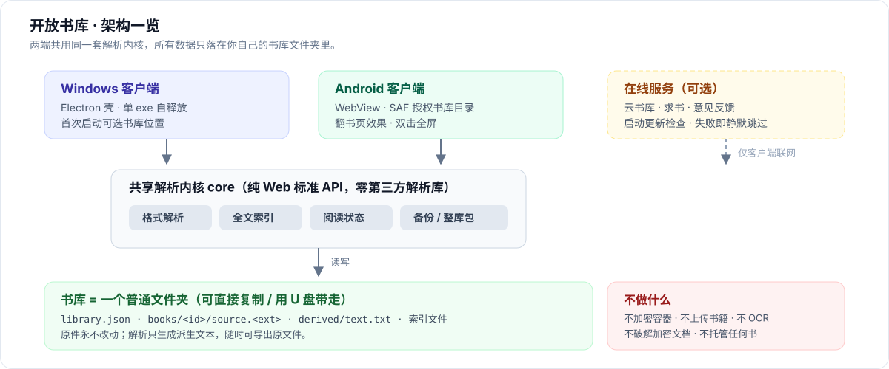
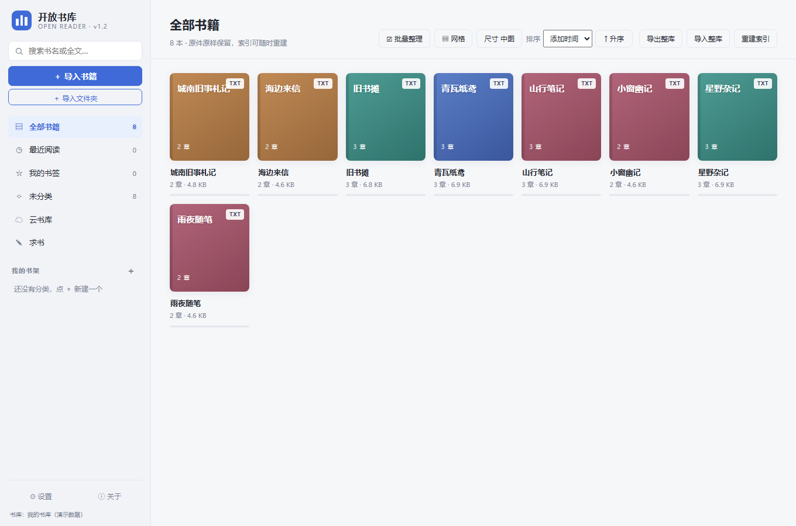
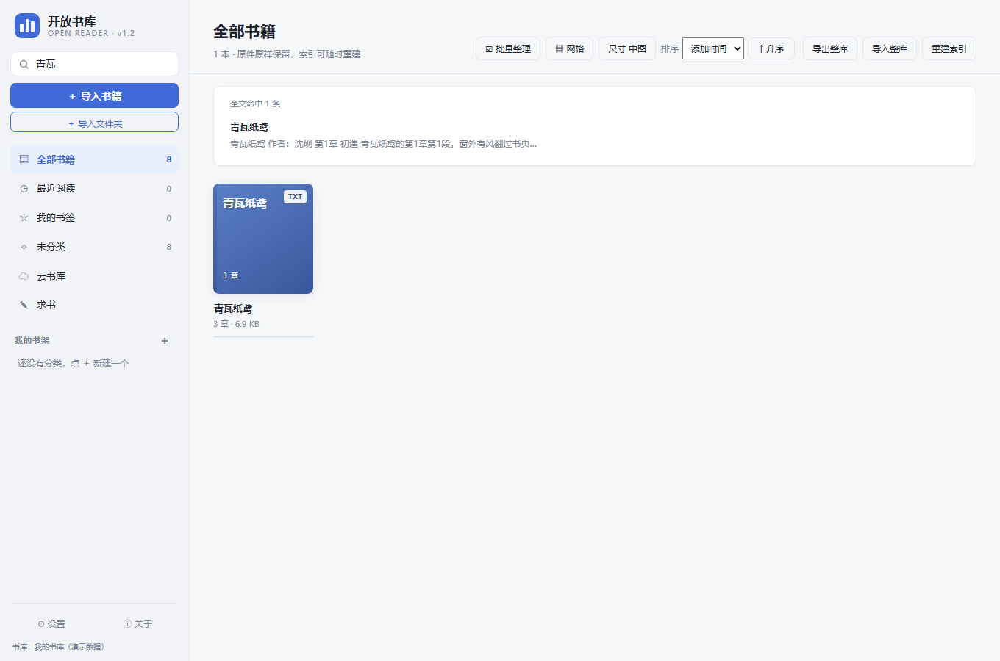
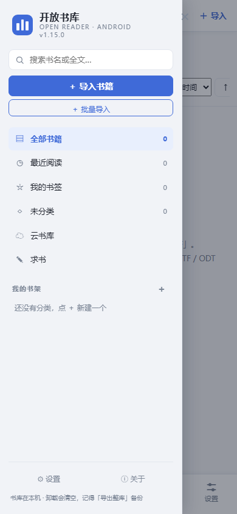
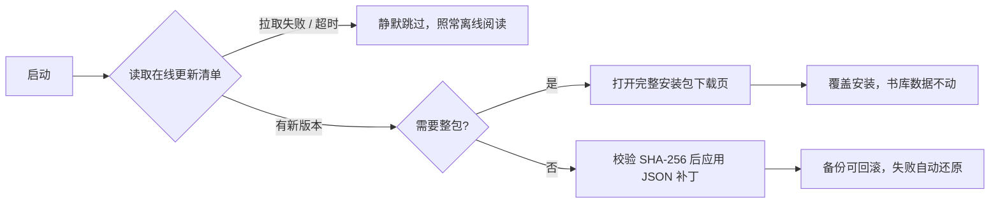

<p align="center">
  
</p>

# 开放书库 · OpenReader

**免费、离线、开放格式的本地电子书阅读器。**

Windows 一个 exe 双击即用，Android 装个 apk 就能看；书库就是一个可以直接拷走的文件夹——没有账号、没有加密容器、没有云同步绑架，你的书和阅读记录始终在自己手里。

- **断网照常读**：更新检查失败会静默跳过，离线阅读不受任何影响
- **原件永不改动**：导入时保留 `source.<ext>`，解析只生成派生的阅读文本，随时可导出原文件
- **自带格式解析**：纯 Web 标准 API 实现，零第三方解析库，桌面端与安卓端共用同一套 core
- 无广告、无收费、无账号体系

## 目录

[它是什么](#它是什么) · [架构](#架构) · [界面一览](#界面一览) · [下载](#下载) · [三分钟上手](#三分钟上手) · [功能详解](#功能详解) · [双平台对照](#双平台对照) · [支持格式](#支持格式) · [书库格式](#书库格式) · [数据与隐私](#数据与隐私) · [常见问题](#常见问题) · [从源码构建](#从源码构建) · [开源范围](#开源范围) · [许可](#许可)

---

## 它是什么

一个把「本地文件」当作唯一真相的阅读器。你给它一个文件夹，它把书、分类、封面、书签、阅读进度都写在里面；换电脑时复制这个文件夹即可，不需要导出、不需要登录、不需要等待同步。

| 适合 | 不适合 |
|---|---|
| 手里有一堆 TXT / EPUB / PDF，想统一整理、全文检索 | 想在线书城直接买书、看连载 |
| 希望断网、没信号、飞行模式下照常看书 | 需要多设备实时同步阅读进度 |
| 在意「哪天不用了能不能把书完整带走」 | 需要扫描版 PDF 的 OCR 文字识别 |
| 想给书分类、做备份、随时导出原件 | 需要打开加密 / DRM 文档 |

> 界面截图里的书名均为演示数据；本项目**不提供、不托管、不分发任何书籍内容**。

## 架构



两端不是两套实现：格式解析、全文索引、阅读状态、备份编解码都放在同一套 `core` 里，PC 用 Electron 包壳，Android 用 WebView 承载。右下角那块「在线服务」是**可选**的——求书、云书库、更新检查都只在客户端发起，服务端不在本仓库内，连不上时软件照常使用。

## 界面一览

### 桌面端

**书架**：左侧分类树，右侧网格 / 列表切换，书卡显示封面、章节数与原件大小。



**阅读**：左侧常驻目录可筛选章节，顶部调字号、主题、书签、全屏，底部翻页并记住进度。


<details>
<summary>展开：全文搜索命中效果</summary>



输入关键词后显示命中章节与上下文摘要，点结果直接跳到对应位置。

</details>

### 安卓端

<p align="center">
  
  &nbsp;&nbsp;
  
</p>

<p align="center"><sub>左：书架与底部导航　右：侧边栏（分类、云书库、求书、设置）</sub></p>

移动端长按书卡弹出归类 / 重命名 / 导出 / 删除；阅读时左右滑动翻页、可切「翻书」仿真效果、双击正文进入全屏。

## 下载

| 平台 | 版本 | Release 附件 | 体积 |
|---|---|---|---|
| Windows | 单文件版 **1.2.4** | `OpenReader-PC-1.2.4.exe` | 约 98 MB（102,730,455 B） |
| Windows 卸载器 | — | `OpenReader-Uninstaller.exe` | 约 228 KB |
| Android | **1.16.0**（versionCode 15，Android 7.0+） | `OpenReader.apk` | 约 475 KB |
| 校验清单 | — | `SHA256SUMS.txt` | 含上述三个文件的 SHA-256 |

> **附件名是英文**，这是 GitHub Release 的限制（中文名会被吞成 `default.exe`）。网盘与本地安装包仍用中文名 `开放书库.exe` / `卸载开放书库.exe`，**字节完全相同**，校验值通用。清单头部写了中英文对应关系。

**国内下载**：打开 `https://soshu.pythonanywhere.com/or/` →「下载 PC 完整安装包」→ 网盘 `https://share.feijipan.com/s/FdzbBKXs`。网盘与 Releases 放的是同一份文件。

下载后建议校验：

```bash
sha256sum -c SHA256SUMS.txt
```

EXE 无数字签名（个人免费软件常见），个别安全软件可能误报，请以校验值为准。

## 三分钟上手

### Windows

1. 双击 `OpenReader-PC-1.2.4.exe`（下载后建议改回中文名 `开放书库.exe`）。
2. 首次运行会展开运行文件（约 5~15 秒，**只做一次**），并询问书库存放位置；点「否」用默认位置。
3. 把 TXT / EPUB / PDF 拖进窗口，或点「导入书籍」。
4. 想换书库位置：在 exe 旁边新建一个空的 `重设书库位置.txt`，再双击 exe。
5. 想卸载：菜单栏「卸载」→ 确认一次即可。不写注册表、不在控制面板留卸载项。

升级不会丢书，覆盖安装即可。

### Android

1. 安装 `OpenReader.apk`，首次打开时授权书库目录（系统文件选择器，SAF）。
2. 导入书籍；长按书卡可归类、重命名、导出、删除。
3. 阅读时左右滑动翻页、双击进入全屏。

两端启动都会检查更新；需要整包更新时会直接打开下载页，覆盖安装不影响书库数据。

## 功能详解

### 书架与整理

| 能力 | 说明 |
|---|---|
| 分类树 | 新建 / 重命名 / 删除 / 隐藏分类，支持层级；把书拖到分类即归类 |
| 排序 | 按添加时间、书名、大小等排序，可切换升序，网格 / 列表 / 紧凑列表 |
| 批量操作 | 批量整理模式下多选，一次删除或移动多本 |
| 封面 | 可为每本书设置封面，未设置时按书名生成色块封面 |
| 阅读进度 | 书卡显示章节数与进度，重新打开从上次位置继续 |
| 长按菜单 | 安卓端长按书卡弹出操作菜单（桌面端用右键 / 批量模式） |

### 阅读体验

- 常驻目录面板，支持按章节标题 / 页码筛选跳转
- 字号、行距、字体可调，三套阅读主题，书签增删与跳转
- 键盘翻页、手势翻页、连续滚动与分页双模式；安卓另有仿真「翻书」效果
- 双击正文进入 / 退出全屏
- 文字版 PDF 按页分章；扫描版 PDF 按原页图片连续浏览（不做 OCR）
- 进度自动记忆，断电或强退后仍能恢复

### 全文检索

对书库建立索引后，输入任意中文子串即可搜到命中章节与上下文摘要，点结果直接跳读。导入新书后可手动「重建索引」。索引是派生数据，删掉可以随时重建，原件不受影响。

### 备份与迁移

| 方式 | 用途 |
|---|---|
| 备份导出 / 恢复 | 自定义文件名与保存位置，涵盖分类、封面、书签、进度、设置 |
| 原件导出 | 把 `source.<ext>` 原封不动导出来，字节不改 |
| `.openlib` 整库包 | 一次导入 / 导出整个书库，适合换电脑 |
| 直接复制文件夹 | 书库是普通目录，用文件管理器整目录拷走即可 |

### 云书库、求书与反馈

客户端内置云书库浏览、求书提交与回复查看、意见反馈入口，以及启动时的更新检查。这些功能连接的是维护者部署的在线服务，**全部可选**：断网、服务不可用、清单拉取失败时一律静默跳过，不影响任何本地功能。

### 更新机制



当前发布版本走「整包下载」路线；补丁通道保留在代码中，用于对小改动做热更新。强制更新时无法跳过，普通更新可选「稍后再说」。

## 双平台对照

| | Windows | Android |
|---|---|---|
| 安装形态 | 单个自释放 exe，无需安装向导 | 一个 apk |
| 书库位置 | 首次启动可选，之后可重设 | 系统 SAF 授权目录 |
| 导入方式 | 拖放 / 选择文件 / 导入文件夹 | 系统文件选择器 / 批量导入 |
| 整理手势 | 拖放归类、右键菜单、批量多选 | 长按书卡、分类弹层 |
| 翻页 | 键盘、点击、连续滚动 | 左右滑动、仿真翻书、双击全屏 |
| 卸载 | 菜单栏「卸载」，不留控制面板项 | 系统正常卸载应用 |
| 共用部分 | `core`：格式解析、索引、阅读状态、备份 | 同左 |

## 支持格式

| 类别 | 格式 | 说明 |
|---|---|---|
| 纯文本 | TXT / MD / LOG / CSV / JSON / XML / SRT | UTF-8 与 GB18030 自动识别 |
| 电子书 | EPUB / FB2 / MOBI / PRC / PDB / AZW | 含 ZIP 内嵌 EPUB / FB2 / TXT（store 与 deflate） |
| 文档 | DOCX / DOC（Word 97–2003）/ RTF / ODT / MHTML / HTML | 纯标准 API 解析 |
| PDF | 文字版 PDF | 按页分章，支持中文 ToUnicode CMap、对象流与常见滤镜 |
| 压缩包 | ZIP 内嵌电子书 | 自动解包取书 |
| 其它 | 未知扩展名 | 按内容嗅探纯文本 |

**不解析但完整保留原件**：AZW3 / KF8、CHM、DjVu、CBZ / CBR —— 可随时导出，不会损坏或丢弃。**边界**：扫描版 PDF 不做 OCR，没有文字层、不支持全文检索；加密文档明确提示降级，不破解。

## 书库格式

书库就是普通文件夹，用文本编辑器或 SQLite 工具就能打开：

```
我的书库/
├─ library.json              # 书籍清单、分类树、封面、书签、进度、设置
├─ books/
│  └─ <book-id>/
│     ├─ source.<ext>        # 导入时的原始文件，永不改动
│     ├─ derived/text.txt    # 解析出的阅读文本（可重建）
│     └─ derived/meta.json   # 章节、分页等派生信息
└─ index.*                   # 全文索引（可重建）
```

三条原则：**原件只读**、**派生可重建**、**元数据是人能读的 JSON**。完整约定见 [`docs/书库格式规范_v0.1.md`](docs/书库格式规范_v0.1.md)，架构与格式解析的更细说明见 [`docs/DEV.md`](docs/DEV.md)。

## 数据与隐私

- 书籍、分类、封面、书签、进度、设置**全部存在本地书库文件夹**，不上传
- 无账号、无登录、无广告 SDK、无行为统计上报
- 联网只发生在你主动使用云书库 / 求书 / 反馈，以及启动时的更新清单拉取
- 更新补丁按文件校验 SHA-256，应用前备份，失败自动还原
- 不提供、不托管、不分发任何书籍；使用者需自行确保对所导入文件拥有合法权利

## 常见问题

**升级会丢书吗？** 不会。覆盖安装只替换程序文件，书库目录独立存放。

**换电脑怎么迁移？** 复制整个书库文件夹到新机器，首次启动时指定该目录即可；或用 `.openlib` 整库包导入。

**杀毒软件报毒？** EXE 无数字签名，属常见误报。用 `SHA256SUMS.txt` 校验，值一致即可放心。

**扫描版 PDF 为什么搜不到？** 没有文字层，程序按原页图片浏览，不做 OCR。

**加密 / DRM 文档能打开吗？** 不能，会明确提示降级并保留原件，不做破解。

**安卓上找不到导入的书？** 确认已授权书库目录，且没有在文件管理器里移动 / 删除该目录。

**断网能用吗？** 完全可以。更新检查失败会静默跳过，阅读、检索、导入导出都是本地操作。

**Windows 书库在哪？怎么换？** 首次启动时选择的位置记录在 `%LOCALAPPDATA%\OpenReader\library-path.txt`；在 exe 旁新建空的 `重设书库位置.txt` 再启动即可重选。

**怎么彻底卸载？** 菜单栏「卸载」会弹一次确认，移除程序文件；书库默认保留，需要的话手动删除书库文件夹。

**代码能拿去用吗？** 见下方「许可」——本仓库**未授予任何使用许可**，仅作项目展示与阅读。

## 从源码构建

```bash
cd desktop
npm install
npm start                 # 浏览器版：http://127.0.0.1:8787
npm run check             # 全套断言（76 项）
npm run fetch:runtime     # 首次：下载 Electron 运行时
npm run build:exe         # 组装绿色版 EXE
```

仓库结构：

```
open-reader/
├─ README.md               # 本页
├─ docs/                   # 开发文档、书库格式规范、PC 使用说明
├─ images/                 # 界面截图与示意图
├─ desktop/                # 桌面端：src / electron / build / test / assets
├─ android/                # Android 端工程、打包与同步脚本
├─ pc-packaging/           # Windows 单文件自释放包、更新清单生成脚本
└─ icons/                  # 图标生成脚本
```

`pc-packaging/` 的网盘地址在公开副本里被替换成占位符，构建时请自行填回；Android 的**签名密钥不在此仓库**。

## 开源范围

本仓库只含**客户端源码**：桌面端、安卓端、PC 打包脚本、图标生成脚本与文档。

求书 / 云书库 / 更新检查所连接的**服务端程序、数据库、管理入口与签名密钥不在此仓库**，由维护者保存在私有仓库与本地备份中。客户端保留了当前公开服务的默认地址，因此 clone 下来就能连现有服务，也可以自行替换成自建服务。

## 许可

**保留所有权利（All Rights Reserved）。** 本仓库的代码与文档仅用于项目展示与阅读，**未授予任何使用、复制、修改、发布、分发或商用的许可**；仓库内不含 `LICENSE` 文件，即不提供开源授权。如需授权或合作，请通过 Issue 联系维护者。

第三方组件：`fflate`（MIT，安卓端 vendor 目录）、Electron / Chromium（各自上游许可证）。本项目不提供、不托管、不分发任何书籍内容。

## 反馈

Bug、建议与格式兼容问题欢迎提 Issue。提 Bug 时请附上系统版本、书籍格式，以及能否在另一种格式上复现。
